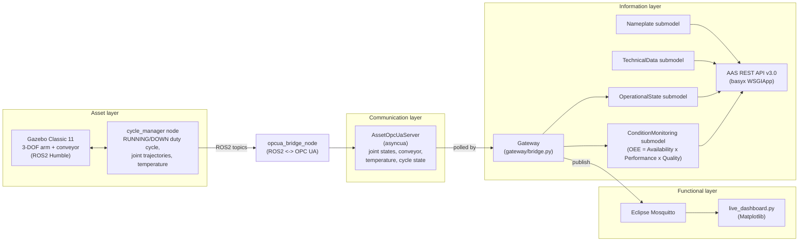
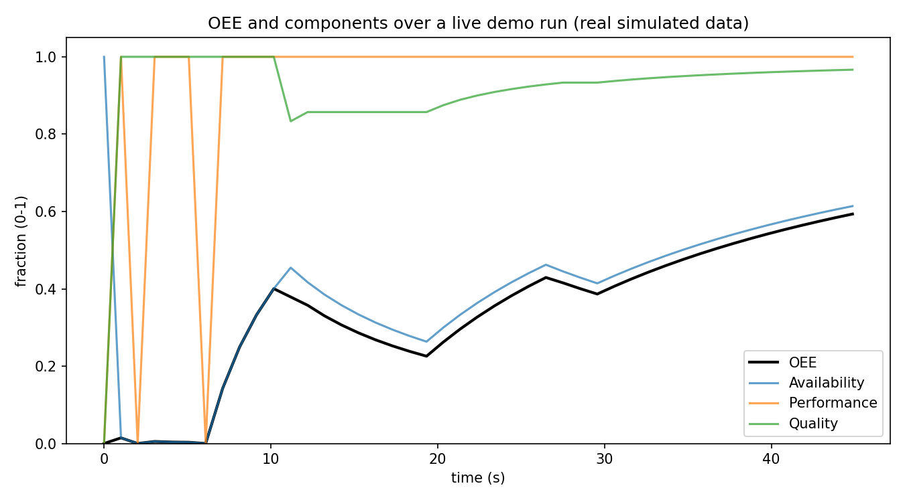

# aas-digital-twin

An Industrie 4.0 digital twin that implements a real Asset Administration
Shell (AAS) per IEC 63278-1, exposing standards-compliant submodels over
OPC UA and MQTT, fed by live telemetry from a simulated 3-DOF robot arm and
conveyor.

## The problem

Most "digital twin" portfolio projects are a 3D viewer wired to fake or
random data. They skip the part that actually makes a digital twin an
Industrie 4.0 concept: a standardized Asset Administration Shell that
exposes an asset's identification, technical data, live state, and
condition through a real protocol stack, so any AAS-compliant tool can
consume it without knowing anything about the underlying asset.

This project implements that shell. There is a simulated asset (a 3-DOF arm
and conveyor in Gazebo), but everything downstream of it, the OPC UA
server, the four AAS submodels, the REST API, the OEE calculation, the MQTT
bridge, is the same code that would sit in front of a real machine.

## Architecture



The demo script (`aas_digital_twin.demo`) drives the same OPC UA / AAS /
gateway / MQTT code path with a lightweight in-process simulator instead of
launching Gazebo each run, so it stays runnable without a ROS2 environment.
The full Gazebo-based asset layer is verified separately (see
[ros2_ws/](ros2_ws/)) and is what the diagram above shows end to end.

Diagrams (Mermaid sources, PNG and SVG) are in [docs/diagrams/](docs/diagrams/). Interview notes are in [docs/INTERVIEW_CHEATSHEET.md](docs/INTERVIEW_CHEATSHEET.md).

## Where this sits in RAMI 4.0

IEC 63278-1 defines the Asset Administration Shell as the standardized
interface between an asset and the digital world, and RAMI 4.0 (the
Reference Architecture Model Industrie 4.0) places it as the boundary
between the **Asset** layer and the **Communication**, **Information**,
and **Functional** layers of a factory's IT stack:

- **Asset layer**: the physical (here, simulated) machine, the Gazebo arm
  and conveyor.
- **Communication layer**: OPC UA (IEC 62541), the standard shop-floor
  protocol for exposing structured, semantically typed data from a
  machine controller.
- **Information layer**: the AAS itself, the four submodels served
  through the standardized AAS REST API v3.0, giving any AAS-aware tool a
  uniform way to read this asset's nameplate, technical data, operational
  state, and condition, regardless of the underlying machine.
- **Functional layer**: the MQTT bridge and dashboard, representative of
  the cloud/MES/analytics layer that consumes AAS data for monitoring and
  decision-making.

This project does not implement the Business layer of RAMI 4.0.

## The four submodels

| Submodel | Content | Source |
|---|---|---|
| **Nameplate** | Manufacturer, product designation, serial number, year of construction | Static |
| **TechnicalData** | Degrees of freedom, max payload, reach, max joint velocity | Static |
| **OperationalState** | Live joint positions, conveyor speed, temperature, cycle state | Live, from OPC UA |
| **ConditionMonitoring** | OEE = Availability × Performance × Quality, plus cycle/good counts | Computed from measured uptime/downtime |

OEE is never hardcoded. `Availability` comes from real elapsed
run-time vs. measured downtime (tracked from the asset's actual
RUNNING/DOWN state transitions), `Performance` from the ratio of ideal to
actual cycle time given the real cycle count, and `Quality` from the real
ratio of good to total parts produced. See
[`src/aas_digital_twin/aas/oee.py`](src/aas_digital_twin/aas/oee.py).

## Repository layout

```
src/aas_digital_twin/
  opcua/server.py       OPC UA server (asyncua) - source-agnostic
  aas/submodels.py      The four AAS submodels (basyx-python-sdk)
  aas/oee.py             Pure OEE calculation
  aas/api.py              AAS REST API v3.0 (basyx's WSGIApp)
  gateway/bridge.py     OPC UA -> AAS -> MQTT gateway
  dashboard/live_dashboard.py   Matplotlib MQTT dashboard
  demo.py                Fixed-duration end-to-end demo
ros2_ws/src/arm_conveyor_sim/
  urdf/                  3-DOF arm + conveyor URDF
  worlds/                 Gazebo world
  scripts/cycle_manager.py     Real duty-cycle state machine (ROS2 node)
  scripts/opcua_bridge_node.py  ROS2 -> OPC UA bridge (ROS2 node)
tests/                    pytest suite (unit + integration)
```

## Installation

Requires Python 3.10+.

```bash
python -m venv .venv
.venv/Scripts/activate     # or `source .venv/bin/activate` on Linux/macOS
pip install -e ".[dev]"
```

The ROS2/Gazebo asset layer additionally requires ROS 2 Humble and Gazebo
Classic 11 (developed and verified here under WSL2 + Ubuntu 22.04):

```bash
cd ros2_ws
colcon build --symlink-install
source install/setup.bash
ros2 launch arm_conveyor_sim factory_cell.launch.py
```

## Usage

Run the test suite:

```bash
pytest
```

Run the fixed-duration demo (OPC UA server, gateway, AAS submodels, and a
real MQTT broker all running in-process, requires a Mosquitto broker on
`localhost:1883`, or pass `use_real_mqtt=False` to skip MQTT):

```bash
python -m aas_digital_twin.demo   # or scripts/run_demo.sh
```

This writes `docs/run_output/telemetry.jsonl` (every MQTT message actually
published during the run) and `docs/run_output/oee_over_time.png` (the OEE
and its components plotted from that same run).

Run the AAS REST API server standalone:

```bash
python -m aas_digital_twin.aas.api
# GET http://127.0.0.1:8080/api/v3.0/shells
# GET http://127.0.0.1:8080/api/v3.0/submodels
```

Run the live dashboard (requires a running gateway publishing to MQTT):

```bash
python -m aas_digital_twin.dashboard.live_dashboard
```

## Example output

The plot and telemetry log below in `docs/run_output/` were produced by
actually running `python -m aas_digital_twin.demo` for 45 seconds against a
live Mosquitto broker. Nothing here is fabricated or hand-edited.



In this run the first fault hit right after the first cycle. About 6 s of
downtime landed inside the first 7 s, so Availability starts near 0 and
Performance flips between 0 and 1 while run time is tiny. This is a small
sample warm-up effect, not a sensor fault. Availability then recovers to 0.61
by 45 s and final OEE is 0.59 (A 0.614, P 1.0, Q 0.967, from the last message
in `telemetry.jsonl`). Performance stays at its cap of 1.0 because the demo
runs simulated cycles faster than the 4 s ideal cycle time.

## Limitations

- The asset is simulated (Gazebo physics, not physical hardware). No
  physical robot or conveyor was used anywhere in this project.
- The OEE metric is illustrative: it is computed correctly from the
  simulator's synthetic uptime/downtime/quality data, but that data is
  generated by a random duty-cycle model, not a real production line.
- The demo script's in-process asset simulator duplicates the duty-cycle
  logic of the ROS2 `cycle_manager` node rather than launching Gazebo
  directly, so it can run without a ROS2/WSL environment. The full
  Gazebo-based path was verified manually (robot spawns, trajectory plugin
  executes waypoints, ROS2 topics carry real telemetry) rather than through
  the automated pytest suite, since it depends on a GUI-capable Gazebo
  process.

## License

MIT. See [LICENSE](LICENSE).
