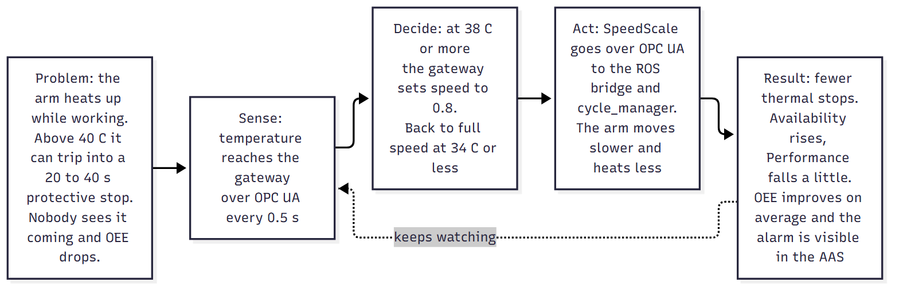
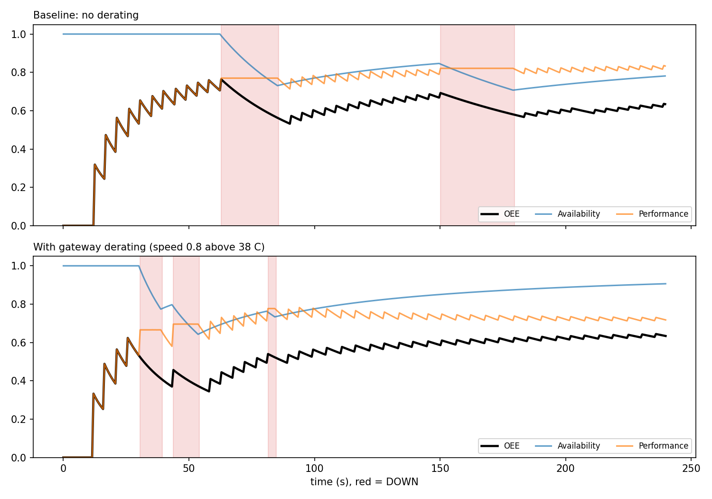
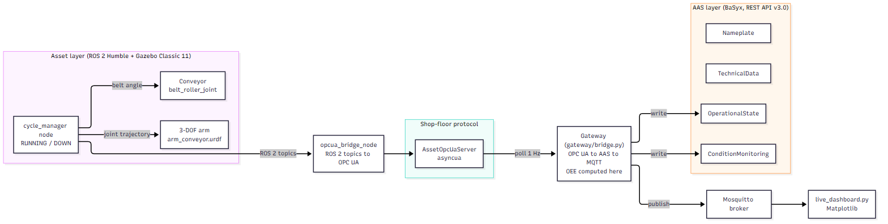
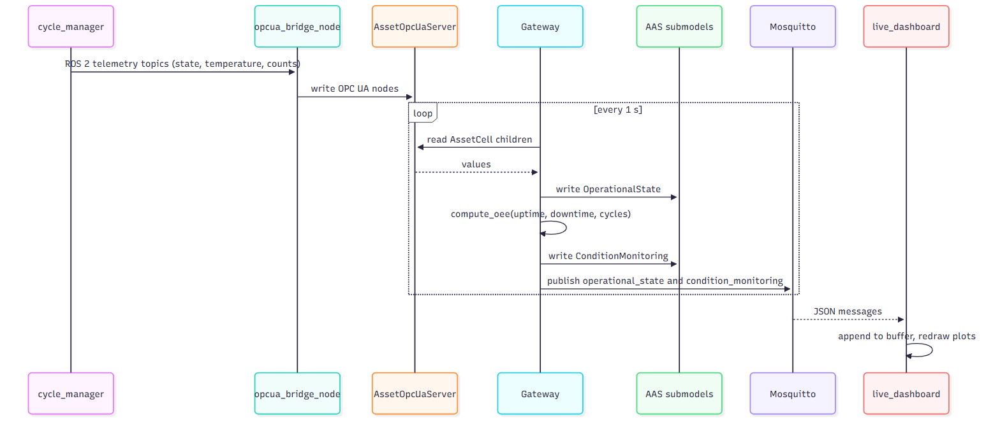
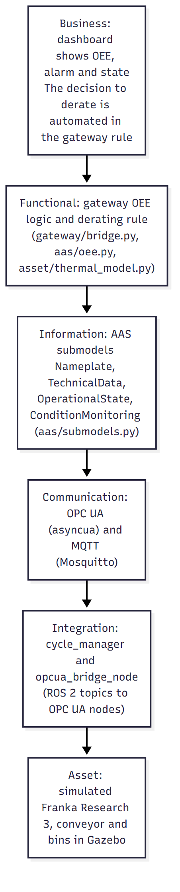
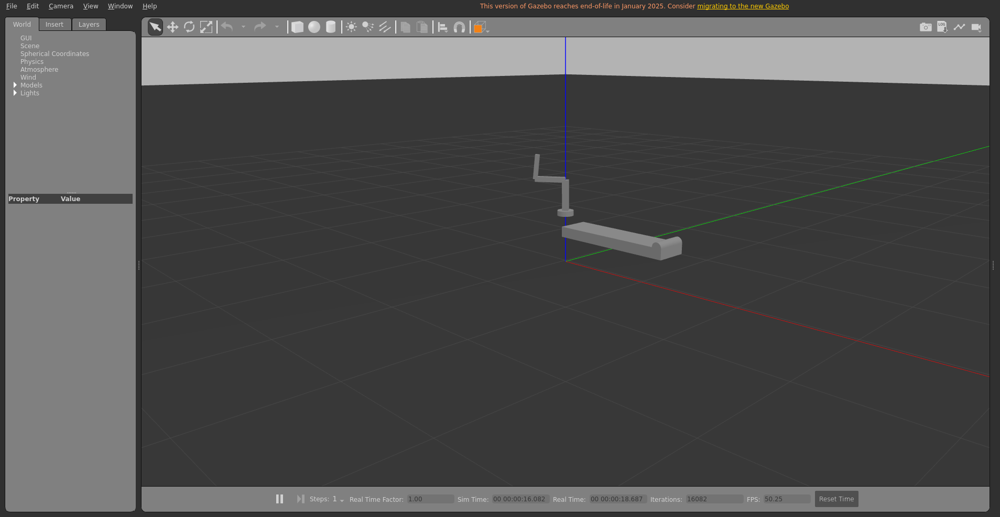
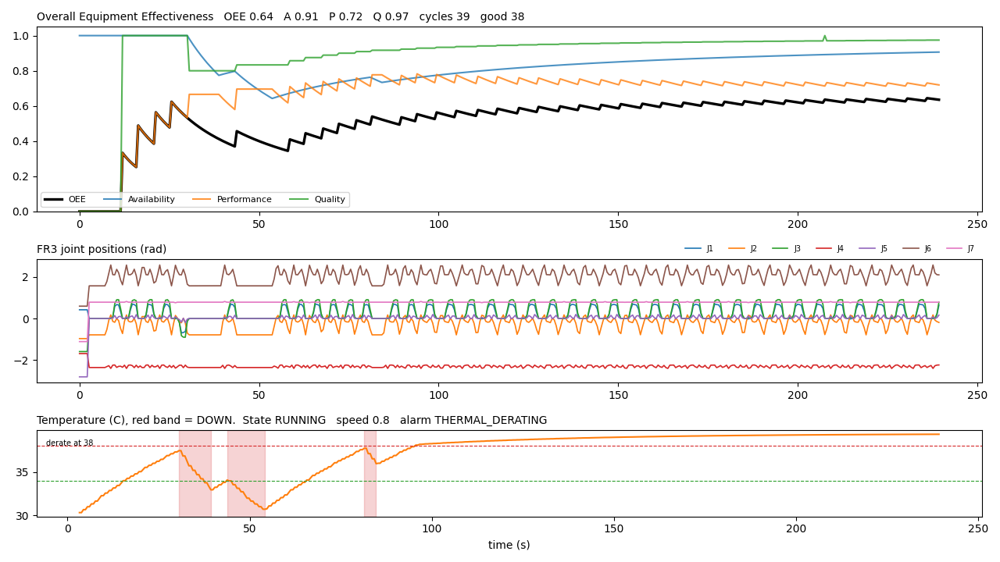

# aas-digital-twin

A digital twin of a Franka Research 3 pick-and-place cell. It follows the
Industrie 4.0 Asset Administration Shell (AAS) idea, watches the cell
through OPC UA and MQTT, computes OEE from measured data, and acts on a
real problem: the arm overheats and stops.

## Problem statement

A pick-and-place cell moves parts from a conveyor into a good bin and a
reject bin. The arm heats up while it works. Above about 40 C the drive
protection can trip, and the cell stops for 20 to 40 seconds while it
cools down. Nobody sees this coming. The plant only notices later that
OEE is low.

This project answers three questions about that cell:

1. **What is happening right now?** State, temperature, joint positions,
   cycle counts, all exposed through standard interfaces (OPC UA, AAS REST
   API, MQTT).
2. **How productive is it?** Availability, Performance, Quality and OEE,
   computed from measured uptime, downtime and cycle counts.
3. **Can the twin prevent the loss?** Yes, in the simulation. The gateway
   watches the temperature. At 38 C it writes a speed scale of 0.8 back to
   the asset over OPC UA and raises an MQTT alert. The arm moves slower,
   heats less, and stays below the trip zone.



The asset is simulated (Gazebo Classic 11, ROS 2 Humble). The Franka
Research 3 model comes from the `franka_description` package, and the pick
and place path is solved with the FR3 kinematics in
[`fr3_kinematics.py`](src/aas_digital_twin/asset/fr3_kinematics.py).
Everything downstream of the asset is the code that would sit in front of
a real machine.

## What the runs show

Two 240 s Gazebo runs of the same cell, one without derating and one with
it. The numbers come from `docs/run_output/ab_summary.json`, which is
computed from the logged CSV files.

| | Baseline | With derating |
|---|---|---|
| Thermal protective stops | 2 | 0 |
| Highest temperature | 42.7 C | 39.3 C |
| Availability | 0.78 | 0.91 |
| Performance | 0.83 | 0.72 |
| Quality | 0.97 | 0.97 |
| OEE | 0.634 | 0.634 |

In this pair of runs the OEE is equal. The derated run happened to hit
three random faults (22 s of downtime), which the baseline did not. One
4-minute run is noisy. The same thermal model run for 300 random seeds
gives a clearer picture:

| 300 seeds, 240 s each | Baseline | With derating |
|---|---|---|
| Thermal stops per run | 1.95 | 0 |
| Availability | 0.73 | 0.96 |
| Performance | 0.91 | 0.76 |
| OEE (mean, standard deviation) | 0.632 (0.044) | 0.693 (0.028) |

Derating trades speed for fewer long stops. In the model that is a net
gain of about 0.06 OEE and a much steadier result. If a trip took only a
few seconds to clear, the trade would not pay off. That assumption is
documented in [`thermal_model.py`](src/aas_digital_twin/asset/thermal_model.py).



The OEE curve is zero for the first 12 seconds and jagged for the next
minute. This is warm-up. The first part has to travel along the belt, and
early values rest on one to five finished cycles, so each new cycle moves
Performance a lot.

## Architecture



| Stage | Module |
|---|---|
| Asset: FR3, conveyor, bins, parts | `ros2_ws/src/arm_conveyor_sim/` (world, launch, `cycle_manager.py`) |
| ROS 2 to OPC UA bridge | `scripts/opcua_bridge_node.py` |
| OPC UA server (asyncua) | `src/aas_digital_twin/opcua/server.py` |
| Four AAS submodels, REST API v3.0 (BaSyx) | `src/aas_digital_twin/aas/` |
| Gateway: OPC UA to AAS to MQTT, OEE, derating rule | `src/aas_digital_twin/gateway/bridge.py`, `run.py` |
| Thermal model and FR3 kinematics | `src/aas_digital_twin/asset/` |
| Dashboard (Matplotlib, MQTT) | `src/aas_digital_twin/dashboard/live_dashboard.py` |

One telemetry update, step by step:



## RAMI 4.0 and IEC 63278-1

IEC 63278-1 describes the Asset Administration Shell: a standard
digital wrapper around an asset that carries its identity, its data and
its services in submodels. RAMI 4.0 is the reference architecture model
that arranges an Industrie 4.0 system in layers, from the physical asset
up to the business. The AAS sits at the boundary between the asset and the
information world.



- **Asset**: the simulated FR3 cell.
- **Integration**: `cycle_manager` and `opcua_bridge_node`.
- **Communication**: OPC UA toward the asset side, MQTT toward consumers.
- **Information**: the four AAS submodels.
- **Functional**: the gateway, with OEE and the derating rule.
- **Business**: only a dashboard. No planning or maintenance system exists.

## The four submodels

| Submodel | Content | Source |
|---|---|---|
| Nameplate | Manufacturer, product designation, serial number, year | Static |
| TechnicalData | 7 degrees of freedom, 3 kg payload, 0.855 m reach, joint speed, conveyor length | Static |
| OperationalState | Seven joint positions, conveyor speed, temperature, cycle state | Live, from OPC UA |
| ConditionMonitoring | Availability, Performance, Quality, OEE, counts, speed scale, active alarm | Computed in the gateway |

OEE is never hardcoded. The formulas are in
[`oee.py`](src/aas_digital_twin/aas/oee.py).

- Availability A = run time / planned time
- Performance P = min(1, ideal cycle time x cycles / run time)
- Quality Q = good cycles / total cycles
- OEE = A x P x Q

The ideal cycle time constant is **4.0 s** (`IDEAL_CYCLE_TIME_S`). The FR3
path takes 4.4 s at full speed, so P is about 0.91 when nothing slows the
cell down.

## Installation

Python 3.10 or newer for the library and tests:

```bash
python -m venv .venv
source .venv/bin/activate
pip install -e ".[dev]"
```

The Gazebo part needs WSL2 or Linux with Ubuntu 22.04, ROS 2 Humble,
Gazebo Classic 11, Mosquitto, ffmpeg and ImageMagick:

```bash
sudo apt install ros-humble-franka-description mosquitto ffmpeg imagemagick xdotool bc
mkdir -p ~/aas_ros2_ws/src && cp -r ros2_ws/src/arm_conveyor_sim ~/aas_ros2_ws/src/
cd ~/aas_ros2_ws && colcon build --packages-select arm_conveyor_sim
```

Build inside the Linux home folder. CMake fails on `/mnt/c`.

## Usage

Tests (a Mosquitto broker on `localhost:1883` enables the live MQTT tests):

```bash
mosquitto -d
pytest
```

In-process demo without ROS or Gazebo (same OPC UA, AAS, gateway and MQTT
code, simulated cell). It runs for 150 s and serves the AAS REST API on
port 8080 while it runs. The URL only answers during the run.

```bash
python -m aas_digital_twin.demo
# in a second terminal, while it runs:
curl http://127.0.0.1:8080/api/v3.0/submodels
```

Full Gazebo run, with video of the Gazebo window and the dashboard:

```bash
DURATION=240 MITIGATION=0 TAG=baseline  bash scripts/run_cell_demo.sh
DURATION=240 MITIGATION=1 TAG=mitigated bash scripts/run_cell_demo.sh
python scripts/compare_runs.py docs/run_output
```

The AAS REST API is served on `http://127.0.0.1:8080/api/v3.0/submodels`
while the gateway runs.

## Example output

These files were produced by running `scripts/run_cell_demo.sh` on the
setup described above.

- Gazebo video: [`docs/media/gazebo_simulation.mp4`](docs/media/gazebo_simulation.mp4)
- Dashboard video: [`docs/media/dashboard_live.mp4`](docs/media/dashboard_live.mp4)
- Short clips of the problem and the fix: [`review_snippet_baseline_thermal_stop.mp4`](docs/media/review_snippet_baseline_thermal_stop.mp4), [`review_snippet_with_derating.mp4`](docs/media/review_snippet_with_derating.mp4)
- OEE plot: [`docs/run_output/oee_over_time.png`](docs/run_output/oee_over_time.png)
- AAS REST output: [`docs/run_output/aas_submodels.json`](docs/run_output/aas_submodels.json)
- Telemetry log: [`docs/run_output/telemetry.csv`](docs/run_output/telemetry.csv)
- pytest result: [`docs/run_output/pytest_output.txt`](docs/run_output/pytest_output.txt)





## Limitations

- The asset is simulated. There is no physical hardware.
- The temperature and the trip behavior come from a documented model, not
  from a real robot. The conclusion "derating helps" holds under that
  model's assumptions only.
- OEE is computed from simulated uptime, not factory data.
- Parts are moved by setting their pose in Gazebo. There is no contact
  physics or grasp simulation.
- There is no image processing in this project.
- OPC UA is polled at 2 Hz. Subscriptions are not implemented.
- There is no authentication or TLS on OPC UA, the REST API or MQTT.
- One Gazebo run per condition is not a statistical result. Use the
  300-seed model run for that.
- The project was built with an AI coding assistant. The author must be
  able to explain every module.

## License

MIT, see [LICENSE](LICENSE).
